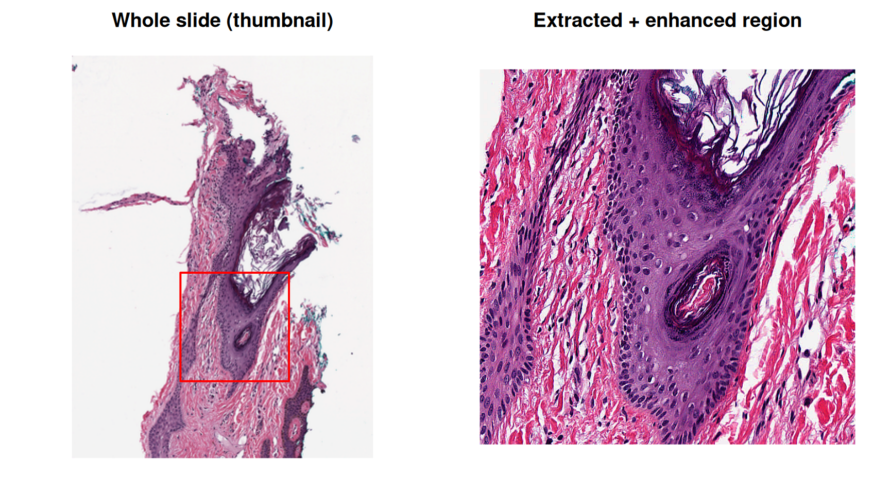

# Whole-Slide Pathology Images: Binary Pipelines Across Environments

## The Problem

Whole-slide images (WSI) used in digital pathology, files like Aperio
`.svs`, Hamamatsu `.ndpi`, or MIRAX `.mrxs`, are not ordinary images. A
single slide is a multi-resolution pyramid of tiled, compressed pixels
that can be tens of gigapixels in size. Reading them requires the
OpenSlide C library. In practice the only convenient, scriptable way to
pull a region out of a slide is a tool built on top of it. The most
common choices are a Python environment (`openslide-python`) or
`libvips` compiled with OpenSlide support.

That creates a real dependency problem for an R user:

- Installing a Python/OpenSlide stack just to read one file format
  pollutes (or conflicts with) whatever environment your actual analysis
  lives in.
- The tool you’d use to *look at* the extracted region needs its own
  libraries. An image processing library like ImageMagick often needs a
  different set of compiled dependencies (its own `libjpeg`, `libpng`
  and `libtiff`). These can clash with the versions OpenSlide/`libvips`
  need.
- None of this is reproducible unless the exact environments are pinned
  somewhere.

This article uses `condathis` to solve all three. Two CLI tools, each
isolated in its own Conda environment, are connected by an operating
system pipe. Binary image data streams from one environment straight
into the other and finally back into R for plotting. Nothing is
installed system-wide and nothing leaks between environments.

## The Slide

We’ll use a real, public test slide from the OpenSlide project: a small
region cropped from an Aperio `.svs` file, about 2 MB.

``` r

data_dir <- fs::path("data-raw")
fs::dir_create(data_dir)

svs_path <- fs::path(data_dir, "CMU-1-Small-Region.svs")

if (isFALSE(fs::file_exists(svs_path))) {
  utils::download.file(
    url = paste0(
      "https://openslide.cs.cmu.edu/download/",
      "openslide-testdata/Aperio/CMU-1-Small-Region.svs"
    ),
    destfile = svs_path,
    mode = "wb",
    quiet = TRUE
  )
}

fs::file_size(svs_path)
#> 1.85M
```

## Two Isolated Toolchains

We need two tools that have no business sharing a Conda environment:

1.  **`libvips`**, built with OpenSlide support, to open the `.svs`
    pyramid and extract pixels from it.
2.  **ImageMagick**, to post-process the extracted region.

``` r

create_env(
  "conda-forge::libvips",
  env_name = "wsi-vips-env",
  channels = "conda-forge",
  verbose = "silent"
)

create_env(
  "conda-forge::imagemagick",
  env_name = "wsi-magick-env",
  channels = "conda-forge",
  verbose = "silent"
)
```

Each
[`create_env()`](https://luciorq.github.io/condathis/reference/create_env.md)
call resolves and installs its own dependency graph. `libvips` pulls in
OpenSlide and `openjpeg`. ImageMagick pulls in its own delegate
libraries. They never see each other.

## Orienting Ourselves: a Thumbnail

Before extracting a region, let’s generate a small overview of the whole
slide with a single
[`run()`](https://luciorq.github.io/condathis/reference/run.md) call.
`vips thumbnail` starts from the smallest pyramid level that is large
enough, so on a full-size slide it does not decode the full-resolution
pixels. This small test slide has a single level, so here it reads all
of it.

``` r

thumb_png <- fs::file_temp(ext = "png")

run(
  "vips", "thumbnail", svs_path, thumb_png, "400",
  env_name = "wsi-vips-env",
  verbose = "silent"
)

thumb_img <- png::readPNG(thumb_png)
dim(thumb_img)
#> [1] 400 299   4
```

## Building the Pipeline

[`run_pipeline()`](https://luciorq.github.io/condathis/reference/run_pipeline.md)
chains two commands, in two different Conda environments, connected by
an operating system pipe managed entirely by the child processes. The
PNG bytes produced by `vips crop` never pass through R. They go straight
into ImageMagick’s stdin.

Each command is described with
[`run_step()`](https://luciorq.github.io/condathis/reference/run_step.md).
It takes the same command, arguments and `env_name` as
[`run()`](https://luciorq.github.io/condathis/reference/run.md), but it
does not run anything by itself. It only records the command, and
[`run_pipeline()`](https://luciorq.github.io/condathis/reference/run_pipeline.md)
then starts every step together and connects them.

``` r

region_png <- fs::file_temp(ext = "png")

# left, top, width, height (pixels) of the region to crop out of the slide
crop_box <- c(800, 1600, 800, 800)

pipeline_res <- run_pipeline(
  run_step(
    "vips", "crop", svs_path, ".png", as.character(crop_box),
    env_name = "wsi-vips-env"
  ),
  run_step(
    "magick", "-",
    "-modulate", "100,150,100", # boost saturation
    "-sharpen", "0x1",
    "png:-",
    env_name = "wsi-magick-env"
  ),
  stdout = region_png,
  verbose = "silent"
)

pipeline_res
#> <condathis_pipeline (2 commands)>
#>   status: OK
#> 
#>   [1] 'vips' 'crop' 'data-raw/CMU-1-Small-Region.svs' '.png' '800' '1600' '800' '800' (wsi-vips-env)
#>        status: OK
#>   [2] 'magick' '-' '-modulate' '100,150,100' '-sharpen' '0x1' 'png:-' (wsi-magick-env)
#>        status: OK
```

Two details are load-bearing here:

- **`stdin`/`-`/`png:-`**: the middle of the pipe is fully binary and
  never touches R. `processx` connects the two child processes’ file
  descriptors directly. R handles only the *first* command’s stdin, the
  *last* command’s stdout, and each command’s stderr. Everything in
  between is a raw byte stream.
- **`stdout = region_png`** on
  [`run_pipeline()`](https://luciorq.github.io/condathis/reference/run_pipeline.md):
  it sends the *last* command’s stdout to a file. The default
  `stdout = "|"` capture decodes output as UTF-8 text, which would
  corrupt binary PNG bytes. Since the final artifact here is a binary
  image, we redirect it straight to a file instead of capturing it as a
  character string. To keep the bytes in memory instead, pass
  `binary = TRUE` to
  [`run_pipeline()`](https://luciorq.github.io/condathis/reference/run_pipeline.md).
  The last command’s stdout then comes back as a raw vector, which
  [`png::readPNG()`](https://rdrr.io/pkg/png/man/readPNG.html) also
  reads.

## Plotting the Result

With the pipeline’s output on disk, reading it into R is a normal
[`png::readPNG()`](https://rdrr.io/pkg/png/man/readPNG.html) call.

``` r

region_img <- png::readPNG(region_png)

th <- dim(thumb_img)[1]
tw <- dim(thumb_img)[2]
# full-resolution width and height of the slide, in pixels
scale_x <- tw / 2220
scale_y <- th / 2967
rx0 <- crop_box[1] * scale_x
ry0 <- crop_box[2] * scale_y
rx1 <- (crop_box[1] + crop_box[3]) * scale_x
ry1 <- (crop_box[2] + crop_box[4]) * scale_y

withr::local_par(mfrow = c(1, 2), mar = c(1, 1, 2, 1))

plot(
  c(0, tw), c(0, th),
  type = "n", xlab = "", ylab = "", asp = 1, axes = FALSE,
  main = "Whole slide (thumbnail)"
)
rasterImage(thumb_img, 0, 0, tw, th)
rect(rx0, th - ry1, rx1, th - ry0, border = "red", lwd = 2)

plot(
  c(0, crop_box[3]), c(0, crop_box[4]),
  type = "n", xlab = "", ylab = "", asp = 1, axes = FALSE,
  main = "Extracted + enhanced region"
)
rasterImage(region_img, 0, 0, crop_box[3], crop_box[4])
```



The red box on the thumbnail marks exactly the region `libvips` cropped
out of the pyramid. ImageMagick then boosted its saturation and
sharpened it. R never holds a raw pixel buffer for anything but the
final, already-small PNG.

## Binary Data In: Raw Bytes as stdin

The pipeline above only needed a *file* as its output.
[`run()`](https://luciorq.github.io/condathis/reference/run.md),
[`run_bin()`](https://luciorq.github.io/condathis/reference/run_bin.md)
and
[`run_pipeline()`](https://luciorq.github.io/condathis/reference/run_pipeline.md)
also accept raw binary data as *input*, written directly to a process’s
stdin. To show it, read the region PNG we just produced back into R as a
raw vector. Then pipe those bytes into ImageMagick’s `identify` without
writing anything new to disk:

``` r

png_bytes <- readBin(region_png, what = "raw", n = fs::file_size(region_png))
length(png_bytes)
#> [1] 1734194

identify_res <- run(
  "magick", "identify", "-format", "%m %wx%h %z-bit %[colorspace]\\n", "-",
  env_name = "wsi-magick-env",
  stdin = "|",
  input = png_bytes,
  verbose = "silent"
)

parse_output(identify_res)
#> [1] "PNG 800x800 8-bit sRGB"
```

`-format` limits the report to the format, size, bit depth and color
space of the image. `input` accepts a character or raw vector. Here we
pass the raw PNG bytes already sitting in R’s memory straight into the
child process, with no temporary file involved.

## Cleaning Up

``` r

remove_env(env_name = "wsi-vips-env")
#> ✔ Environment wsi-vips-env successfully removed.
remove_env(env_name = "wsi-magick-env")
#> ✔ Environment wsi-magick-env successfully removed.
```

## Why This Matters

- **Isolation**: `libvips`+OpenSlide and ImageMagick never share a
  dependency graph, so there’s no solver conflict to fight and each can
  be upgraded independently.
- **True binary pipes**: data moves between the two Conda environments
  as raw bytes over an operating system pipe, exactly like a shell `|`.
  R handles only the first command’s stdin, the last command’s stdout,
  and each command’s stderr.
- **Reproducibility**: the whole toolchain, from slide to plotted
  region, is defined in this article. Anyone who runs it gets
  environments built from the same package specs. Pin the versions of
  `libvips` and `imagemagick` in the
  [`create_env()`](https://luciorq.github.io/condathis/reference/create_env.md)
  calls to get the same tools, and the same pixels, on every run.
